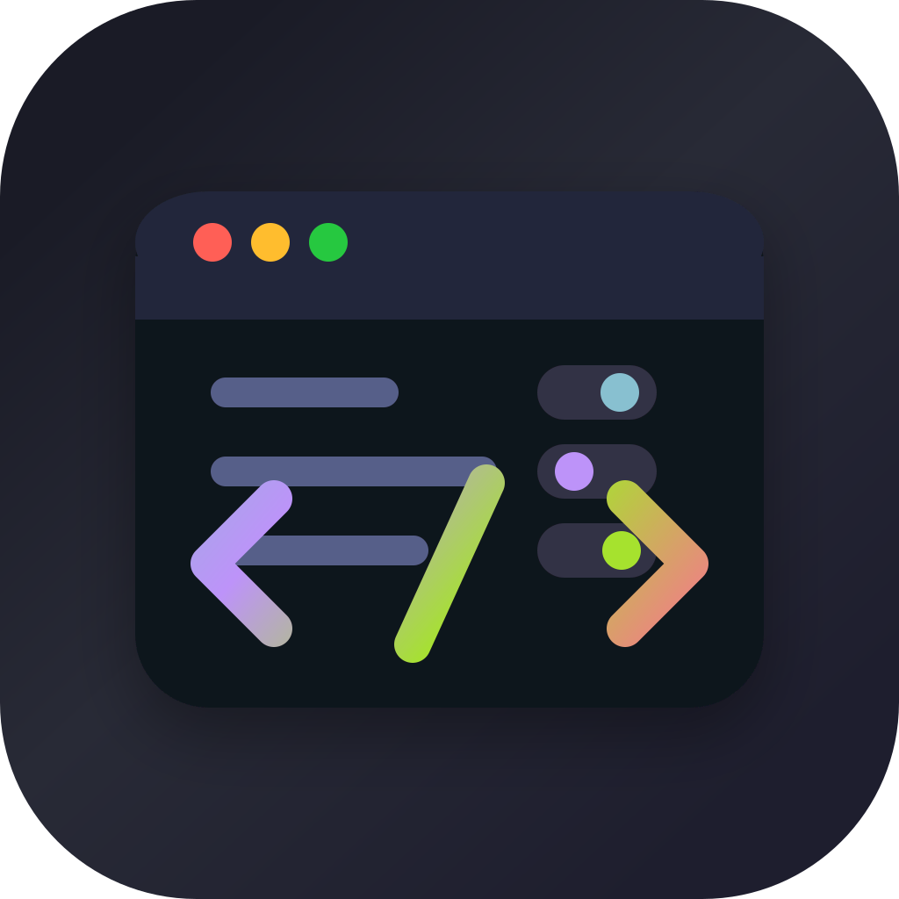

<div align="center">

  

  <h1>SketchyBar Studio</h1>

  <p><b>Edit your SketchyBar config. Keep it yours.</b></p>

  <p>
    A native macOS editor for existing SketchyBar configurations.<br/>
    Safer edits, clearer structure, and backups before every write.
  </p>

  <p>
    <a href="https://github.com/wiggly-sheets/SketchyBar-Studio/actions/workflows/ci.yml"></a>
    <a href="LICENSE"></a>
    <a href="https://github.com/wiggly-sheets/SketchyBar-Studio/releases/latest"></a>
  </p>

  <p>
    <a href="https://github.com/wiggly-sheets/SketchyBar-Studio/releases/latest"><b>Download</b></a>
    &nbsp;·&nbsp;
    <a href="#installation">Install guide</a>
    &nbsp;·&nbsp;
    <a href="#build-from-source">Build from source</a>
    &nbsp;·&nbsp;
    <a href="#safety">Safety</a>
  </p>

  

</div>

---

SketchyBar Studio helps you explore and edit the SketchyBar setup you already have, without turning your configuration into an app-owned project. It follows your folder structure, provides native controls for common values, and keeps writes narrow and backed up.

> [!NOTE]
> Your configuration remains ordinary Lua, `sketchybarrc`, and shell files. Studio does not replace the files or take ownership of them.

---

## Features

### Your configuration, made navigable

- Opens `~/.config/sketchybar` by default, or any other SketchyBar config folder.
- Supports Lua files alongside `sketchybarrc`, `.sketchybarrc`, and shell-based configurations.
- Presents a path-first sidebar: `items`, `widgets`, `bar`, `themes`, and `scripts`, including nested folders. Item folders named `left`, `center`, or `right` are recognized directly; otherwise items are grouped from their simple `position` values, including compact Lua item tables.
- Finds files and editable values with search, and can show only unsaved changes.
- Keeps a read-only, hideable code preview close to the editor. The preview shows the pending draft, so it matches what will be written to disk.
- Shows the diff of a save before the file is written. The sheet shows the file on disk and the text that would be written, line by line, and the file is only written after the change is accepted.
- Shows a reachability map of the config: the files the loaders reach, the files no loader loads, the loader lines that point at files that are gone, and the require cycles. The map only reads the config.
- Checks the config for the problems SketchyBar silently ignores: unknown options, values SketchyBar cannot use, duplicate item aliases, missing require targets, orphan files, unbalanced brackets, and item files that declare nothing. The diagnostics sheet names the file and the line of every finding, and clicking a finding reveals the file in Finder. The check only reads the config.
- Finds the item files of the config that are nearly the same. The duplication finder shows the pairs of files that match, how much they match, and the keys that drifted apart with both values side by side. It only reads the config.

### Purpose-built editing

- Uses dropdowns for known SketchyBar options and toggles for ordinary booleans.
- Shows an option reference for most SketchyBar options: an info button next to the key path opens a popover with the meaning, the type, the accepted values and the default of the option. The entries follow the SketchyBar property table, and the summary names the level of the option.
- Includes an interactive draft bar preview: drag items to reorder them or move them between left, center, and right; drag a numeric-width handle to resize; and adjust available left/right padding without writing files until you save.
- Draws the bar preview with the real values of the config: an SF Symbol, the icon of an installed app, a media artwork or the text of the icon, the real label, and the font, the text color and the background color of the item. A symbol SketchyBar would reject is marked with a warning.
- Provides a built-in source editor for complete Lua and `sketchybarrc` files, with optional Vim-style navigation (`h/j/k/l`, words, line start/end, `i`/`a`, Escape). Source saves use the same backup protection as structured edits.
- Opens the native macOS color picker, saving colors as `0xAARRGGBB`.
- Opens the native macOS font panel, saving SketchyBar font syntax.
- Groups controls into practical sections such as item, icon, label, background, popup, and scripts.
- Reads nested SbarLua item tables with their full key path, such as `icon.font.size` or `background.border_color`, so a value of the icon is never mixed up with a value of the label.
- Normalizes boolean-style values to `true` and `false`, while preserving SketchyBar-specific choices such as `updates = on/off/when_shown`.
- Creates new bar items from a template: the "Add Item" toolbar button opens a wizard with ready made items such as clock, battery, volume, Wi-Fi, media, space and front app. The wizard shows the file it is about to write, writes it in the folder you choose, and adds the matching `require(...)` line to the loader file. Both steps can be undone.
- Undoes and redoes value edits, source edits, discards, loader reorders and activation toggles with Cmd-Z and Cmd-Shift-Z. The Edit menu names the change that will be undone.

### Activation and ordering

- Turns loader-backed items on or off by commenting or uncommenting their loader references.
- Detects common Lua and shell loader patterns in `init.lua`, `sketchybarrc`, `.sketchybarrc`, and related loader files. A `sketchybarrc` that holds Lua code is read as Lua, so its `require(...)` lines can be switched off like any other loader reference.
- Reorders items when Studio can identify concrete activation references; complex loader code is left alone.
- Avoids offering core entrypoints and theme files as activatable items.

### Config library and profiles

- Keeps a library of config folders, including symlinked configs in dotfiles repositories.
- Saves and restores full config-folder snapshots as per-config profiles.
- Can make a selected config live by pointing `~/.config/sketchybar` at it, with a confirmation step and backup of an existing real folder.
- Saves all edits and optionally runs `sketchybar --reload` to apply them.

### Native macOS experience

- Built as a native SwiftUI app for macOS 14 and later.
- Uses familiar macOS controls, including file panels, color picker, font panel, settings, and split views.
- Includes Nord, Dracula, Monokai, Tokyo Night, and Catppuccin app-only themes.

---

## Download

<div align="center">

<a href="https://github.com/wiggly-sheets/SketchyBar-Studio/releases/latest"></a>

</div>

---

## Installation

SketchyBar Studio preview builds are ad-hoc signed, but not Developer ID signed or notarized. You can install the universal DMG release or build it yourself.

### Install with Homebrew

```bash
brew tap wiggly-sheets/sketchybar-studio
brew trust wiggly-sheets/sketchybar-studio
brew install --cask sketchybar-studio
```

### Install from a release

1. Download the universal `.dmg` from the [latest release](https://github.com/wiggly-sheets/SketchyBar-Studio/releases/latest).
2. Open the DMG and drag **SketchyBar Studio** to your Applications folder.
3. Open the app from Applications.

### Opening a preview build

Because preview builds are not Developer ID signed or notarized, macOS may block the first launch. Open **System Settings → Privacy & Security** after that attempt and choose **Open Anyway**, or Control-click the app and choose **Open**.

If macOS still blocks an app that you downloaded from a source you trust, remove its quarantine attribute:

```bash
xattr -dr com.apple.quarantine /Applications/SketchyBarStudio.app
```

If the app lives elsewhere, use its actual path instead.

---

## Safety

SketchyBar Studio is deliberately conservative about config changes.

| What Studio does | What that means |
| --- | --- |
| Makes copies under `backups/` before writing | You have a local backup of the original file before an edit is saved. The backup holds the exact text that is about to be overwritten. |
| Shows the diff before it writes | A save opens a review sheet with the file on disk and the text that would be written, so a change is checked before it reaches the file. |
| Keeps the quoting of a shell value | A value keeps the quotes it had in the file, so `$HOME` still expands and a single quoted value stays literal. |
| Restores profiles without losing the `backups/` folder | The backup mirror of your config root is still there after a restore. |
| Edits simple scalar assignments | Complex Lua tables and computed values are not silently rewritten. |
| Follows folders and symlinks | A config stored in a dotfiles repository remains in place. |
| Changes loader order only when references are clear | Unusual or complex loader logic is not inferred or rewritten. |
| Keeps unsaved edits in memory and asks before quitting | Quitting with unsaved edits offers Save All, Discard, or Cancel instead of dropping them. |
| Keeps drafts when a file changes on disk | A draft follows its value even when lines move, and it is reported when the value is gone. |
| Never moves a draft to another value | An edit stays on the value it was made on. When that cannot be proven, the draft is reported instead of written to another item. |
| Says what it could not save | A file that is missing from disk is named in the status message, and its draft stays in memory until the file is back. |

You can use the GUI for routine changes and keep the code preview open whenever you want to verify the underlying configuration.

---

## Build from source

### Requirements

- macOS 14 or later
- Xcode with Swift 5.9 or later
- [SketchyBar](https://github.com/FelixKratz/SketchyBar) installed when testing live reload behavior

### Clone and run

```bash
git clone https://github.com/wiggly-sheets/SketchyBar-Studio.git
cd SketchyBar-Studio
./script/build_and_run.sh
```

To build without launching:

```bash
swift build
./script/build_and_run.sh --package
```

The packaged app is written to `dist/SketchyBarStudio.app`.

### Build a universal app

To package a release-style app for both Apple Silicon and Intel Macs:

```bash
./script/build_and_run.sh --universal-package
lipo -info dist/SketchyBarStudio.app/Contents/MacOS/SketchyBarStudio
```

---

## Known limits

- Lua editing intentionally targets simple scalar assignments first; tables and computed values remain read-only context.
- Shell support covers common `key=value` SketchyBar property assignments.
- Unusual loader patterns may require future activation-detection support.

## Inspiration

SketchyBar Studio is built for the ecosystem around:

- [SketchyBar](https://github.com/FelixKratz/SketchyBar) — the macOS menu bar customization tool it edits and supports.
- [SbarLua](https://github.com/FelixKratz/SbarLua) — the Lua API used by many modern SketchyBar configurations.

## Contributing

See [CONTRIBUTING.md](CONTRIBUTING.md) for development and pull-request guidance.

## License

MIT. See [LICENSE](LICENSE).
